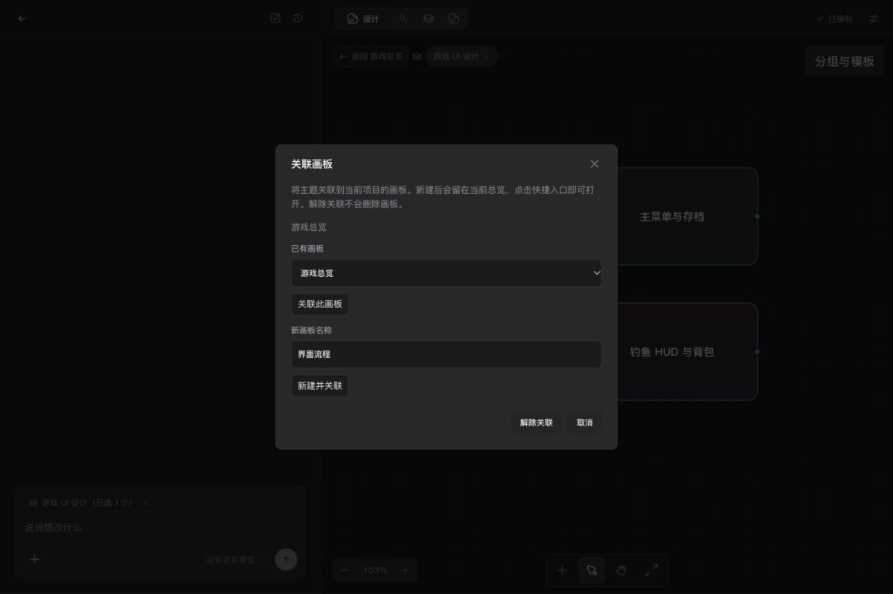
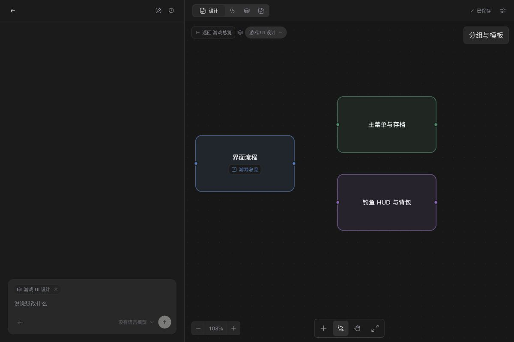

# Link planning topics to canvas boards

[中文](canvas-board-links.zh-CN.md)

Use a [mind map](canvas-diagrams.md) as a game overview, and link complex topics
to detailed boards in the same project. Design and Asset Canvas both support this.
No provider connection or generation credit is required.

## Use

1. Select a topic and click **Link canvas board** (the arrow icon next to Diagram
   tools). Choose an **Existing board**, or enter a **New board name** and click
   **Create and link**. The default name comes from the topic, up to 120 characters.
2. Creating/linking keeps you on the overview. Click the topic's board badge to
   open the detailed board. Double-clicking the topic text still edits its text.
3. Use **Back to …** beside the board selector to return. Current edits are saved
   before navigation, and each board restores its saved position and zoom.
4. Open **Link canvas board** again to change the target or **Unlink board**.
   Neither unlinking nor removing a topic deletes the linked board. These topic
   edits use the existing autosave and undo/redo system.

For example: **Game overview → Fishing gameplay → Fish behavior**, while a
separate **UI** topic can also reference **Fishing gameplay**. Links do not create
an ownership hierarchy: many topics may share a board, and cycles are allowed.
The project supports up to 100 boards, including boards created from topics.





## Navigation and recovery

- Return history belongs to the current workspace session, is limited to 50
  transitions, and survives switching between Asset Canvas's internal canvas and code
  views. Reloading or leaving Design/the workspace clears it. Selecting a board manually
  or creating one from the board selector starts a new route.
- A failed save or target lookup keeps you on the current board and reports the
  error. Rapid clicks cannot start overlapping transitions.
- Back skips deleted destinations. If every destination was deleted, the trail
  is cleared and an unavailable-board message is shown when Back is invoked.
- Renames update badge/return labels from the workspace index; references use IDs.
  Deleted or unavailable targets remain visible as repairable badges. Click one
  to relink or unlink; the app does not automatically delete or replace references.
- Copying topics within the same project preserves their links. Copying to a
  different project preserves source identity but shows **Relink board** and does
  not open a board in that other project. Project duplication/export may likewise
  require relinking when project IDs change.
- Board creation and topic saving are separate operations. A new board remains
  available in the board selector if the later topic save fails or is undone;
  link it through Existing board rather than creating it again. If creation itself
  fails, the dialog retains its name and can be retried.

## File contract and scope

An optional topic field stores a project-scoped navigation reference:

```json
{
  "text": "Fishing gameplay",
  "boardLink": { "projectId": "project-id", "boardId": "board-id" }
}
```

The board ID follows the canvas index ID rules. Names, absolute paths and callback
functions are not stored. These links are independent of diagram relationships
and generation references. Existing topics without links need no migration.
Generated canvas schemas and instructions document the field; custom project
instructions are preserved. Older schema versions may reject the new field:
back up projects before opening them in an older application.

This version supports one board link per topic within the current project.
External URLs, cross-project opening, links to individual nodes/documents,
automatic backlinks, and a persistent browser-style navigation history are not
implemented. Mermaid/Markdown diagram export describes the diagram itself;
project-local navigation links remain in the native board JSON.

## Development and verification

The focused `feat/canvas-board-links` branch builds on `feat/canvas-diagrams`
(PR #4), itself based on `studio`. Its PR targets `RemixCat/ohmygame:studio` and
declares that prerequisite; review the new commits separately from that dependency.
The integration preview includes the feature together with the existing Studio
extensions. There is no new packaged installer associated with this change.

Behavior is covered by `test/canvas-board-navigation.test.tsx`,
`test/canvas-board-links.test.ts` and `test/canvas-diagram-ui.test.tsx`: save/read
failures, nested/cyclic/back navigation, deleted destinations, rapid clicks,
creation/retry, linking/unlinking/undo, rename/reload, source identity and native
file persistence. Screenshots use an isolated local fixture with no provider keys
or user project content. Public checks and actual UI acceptance are recorded in
the contribution PR.

Local acceptance: plugin preparation, changelog validation, typecheck, renderer build and Node daemon/player checks passed; 2,914 tests passed and 23 expected tests skipped. The initial parallel run hit the existing 1.5-second preview-spawn timing assertion; its focused 16-test suite and the full suite with two workers then passed. Real UI checks covered linking/creating, save-and-return with identical viewport, cyclic navigation, reload, and widths 360/520/720/1200 pixels.
