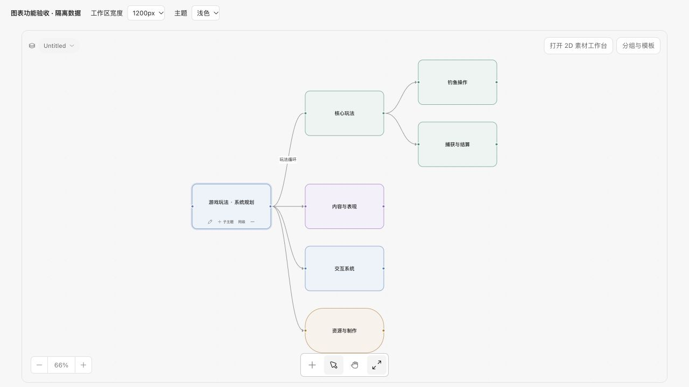
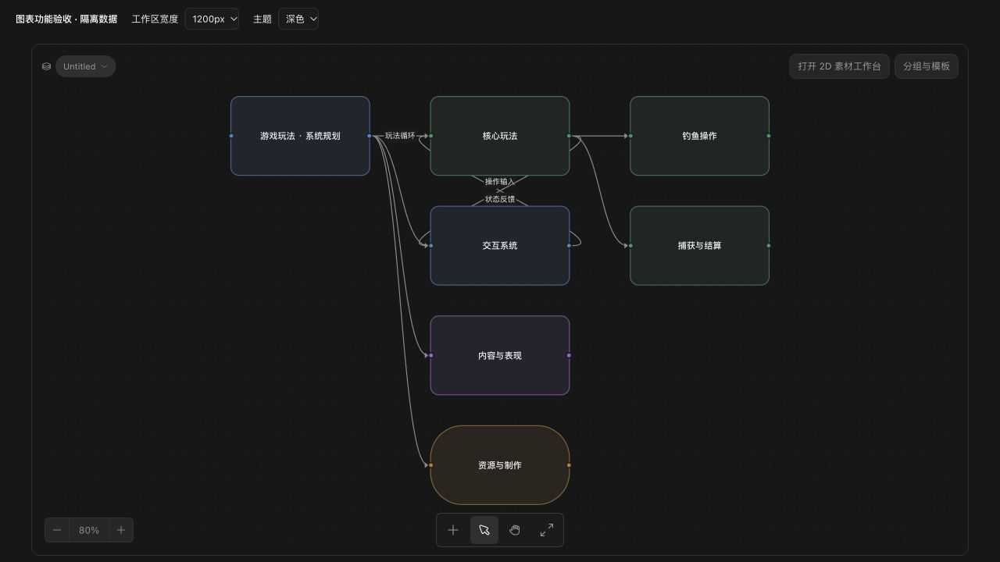

# Mind maps and topology diagrams

[中文](canvas-diagrams.zh-CN.md)

Design and Asset Canvas can mix native diagram topics with documents, media and
production workflows. Everything runs locally, with no provider key or generation
charge. This feature is implemented on `feat/canvas-diagrams`; the integration
preview also includes the separate workspace-picker, SpriteCook and Studio UI
changes.

## Create and edit

1. Open a canvas, click **Add node → Mind map / topology**, or use the same entry
   in the empty-canvas context menu. This adds a central topic and two branches.
2. Double-click a topic, or focus it and press **Space/F2**, to edit its text.
   **Enter** commits, **Shift+Enter** adds a line, and **Escape** restores the text
   from when editing began. Typing is included in autosave before blur.
3. Focus a selected topic and press **Tab** to add a child or **Enter** to add a
   sibling. The card's buttons provide the same actions. **Shift+Tab** keeps normal
   keyboard navigation. The viewport follows a new topic when needed.
4. Drag from a topic's right port to another topic's left port. The existing
   larger connection target also accepts a compatible card. Cross-links and cycles
   are allowed; duplicate wires in the same direction are ignored.
5. Open **Diagram tools** from a selected topic's ellipsis. Choose a color or
   shape, select a relationship and edit its label or direction arrow. A double-click
   on a relationship opens its editor directly. Reciprocal labels are separated.

## Arrange and share

**Arrange tree** builds a non-overlapping spanning forest. **Arrange topology
layers** assigns breadth-first levels and keeps cross-linked peers adjacent.
Both preserve every relationship, including cycles and shared children. They act
on the selected connected diagram, keep other diagrams/media in place, and fit the
result into view. Drag cards to refine routes in dense graphs.

**Add independent topic** creates a separate diagram. Diagram tools exports only
the current connected component:

- **Mermaid**: quoted, escaped node labels and every directed/undirected edge.
- **Markdown**: a topic list and relationship list, retaining cross-links/cycles.

Copy the preview or download `.mmd`/`.md`. Imports, image/SVG export, dedicated
branch collapse, a full orthogonal obstacle router and XMind compatibility are
not included in this first version. Existing canvas groups can group/collapse
topics. Deleting a topic removes its incident wires and keeps other topics;
ordinary selection, copying, grouping, undo and redo remain available.

## Persistence and the agent

Topics use `type: "topic"` with `data.text` (up to 2000 characters), optional
`color` (`blue`, `green`, `orange`, `purple`, `gray`) and `shape` (`card`, `rounded`,
`pill`). Relationships use `kind: "diagram"`, optional `label` (up to 200 characters)
and `directed` (defaults true). Both endpoints must be different topics.
`sourceHandle: "out"` is the output port. Positions remain in the normal editor
layout; topic cards have an intrinsic 224 × 128 size.

Relationships do not declare generation dependencies or connect topics to media
inputs. Normal reference/prompt connections keep their existing semantics. Board
validation, revision conflicts, autosave and draft/undo recovery apply. The same
2000-node/8000-edge board limits apply. The agent can use normal file tools and
`canvas_check`; generated guidance and schemas describe the new contract, while
custom agent instructions are preserved.

Old applications do not recognize topic nodes. Back up boards/layouts before
opening them in an older version; deleting unsupported nodes is not a migration.

## Validation

Tests cover schema/semantic rejection, serialization, copying, 2000-node cyclic
layouts, collision-free quick-add, export escaping, feedback label separation,
keyboard/IME behavior, autosave before blur, undo/redo and generated-guidance
updates. Isolated browser checks exercise real save/reload, cross-links and a
feedback loop, appearance/labels/direction, layout, clipboard copy and downloaded
Markdown. Canvas and topic controls were checked in both themes at work-area
widths 1200, 960, 720, 520 and 360 px; controls and reciprocal labels did not
overlap. Screenshots are local fixtures, with no real project changes or paid
generation. The integration preview's public checks pass; detailed counts are
recorded in the pull request.

The integration preview passed **2947 tests**, with **23 expected skips**, plus
typecheck, plugin/changelog checks, renderer/sandbox builds and Node startup.
Electron was restarted with these builds and its real Add menu was checked; no
diagram was inserted into the user's existing project during acceptance.
