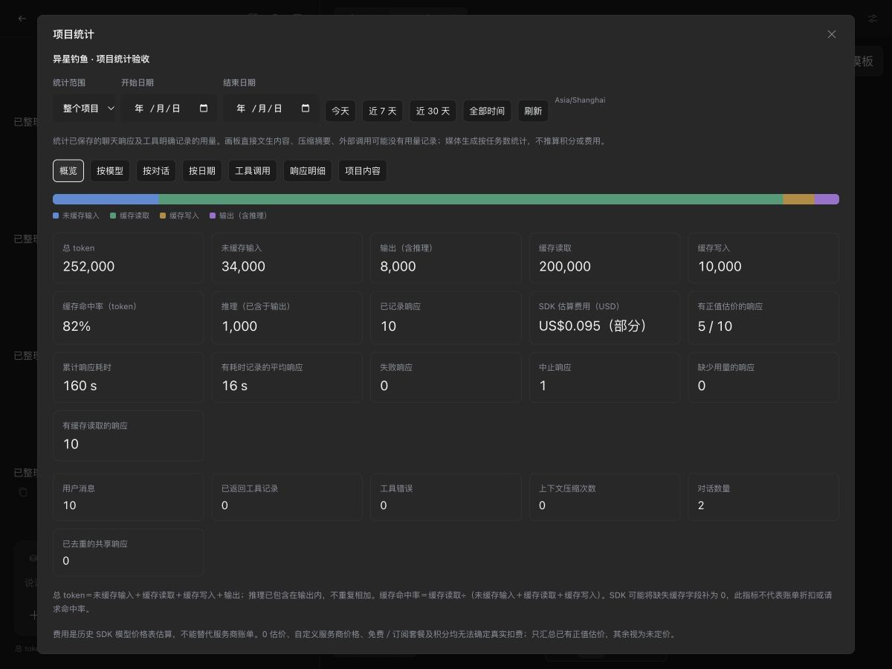
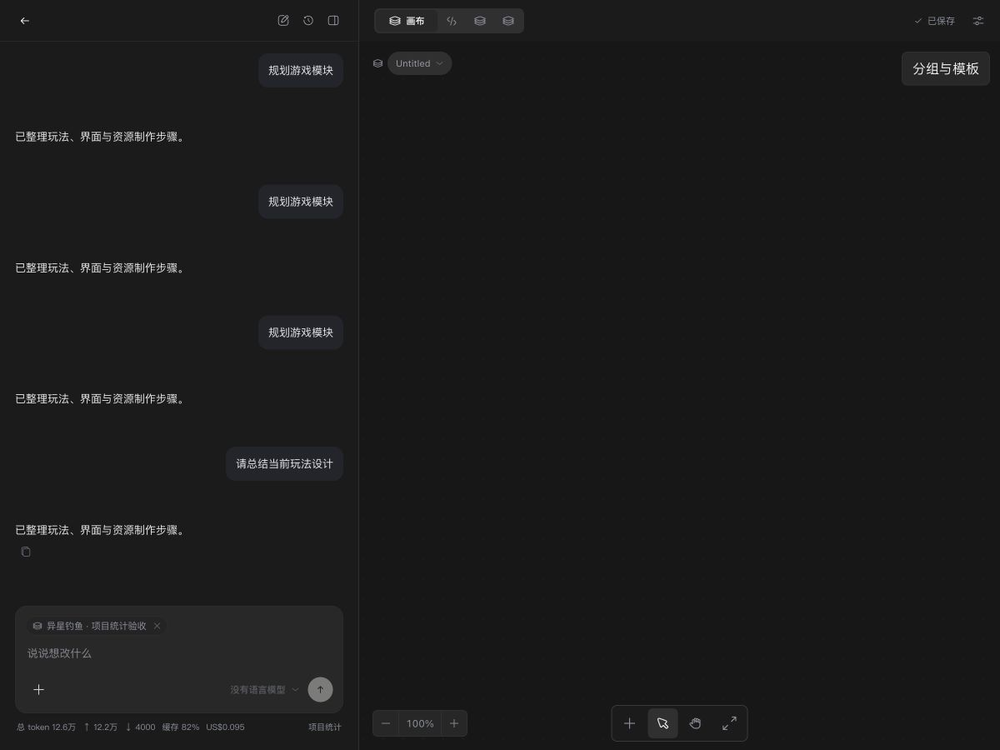

# Conversation usage and project statistics

[中文](project-statistics.zh-CN.md)

The `feat/project-usage` contribution branch adds local reporting based on retained
conversation files and project metadata. It starts from `studio`, without requiring
the diagram or SpriteCook contribution branches. The integration preview also
includes this feature. There is no separate packaged installer from this change.

## Open the report

- The bottom of the chat composer shows cumulative conversation tokens, incoming
  tokens (including cache reads/writes), outgoing tokens, token-weighted cache hit
  rate, and available SDK cost estimates. Click this summary for conversation
  details, including the latest saved response.
- **Project statistics** beside the summary opens the project report. The same
  entry is available in project cards' ellipsis menu on Home and Projects.
- Switch between the current conversation and the whole project. Choose Today,
  Last 7 days, Last 30 days, or an inclusive start/end date. The report uses the
  browser's local IANA timezone, which is shown beside the filters.
- Project reports group usage by model/provider, conversation and date, and show
  top-level returned tool records, response details, and current canvas content.
  Response rows include completion/error/abort status, input/output/cache counts,
  total tokens, available reasoning breakdown, estimate, and response duration.
- **Export JSON** contains summaries and available detail rows for the selected
  scope/dates. **Export response CSV** contains detail rows with explicit usage
  and pricing availability fields. The newest 500 response rows are retained in
  the response list/export, paged 50 at a time. Aggregate/model/day totals use all
  retained records, including those outside this detail limit.

The footer refreshes after selecting a conversation and changing running state,
then approximately every 3 seconds while running and 30 seconds while idle.
Hidden documents reduce polling frequency. Usage appears after a response is
saved; streaming text does not provide a reliable live token counter. Failed
reads show unavailable/retry or identify the last snapshot, instead of inventing
zero usage. Project reports refresh when opened, filtered, or manually refreshed.

## Counting rules

| Metric              | Definition                                                                                            |
| ------------------- | ----------------------------------------------------------------------------------------------------- |
| Uncached input      | Pi's normalized `usage.input`                                                                         |
| Output              | `usage.output`, including reasoning when the provider reports it there                                |
| Cache read/write    | Pi's normalized `usage.cacheRead` / `usage.cacheWrite`                                                |
| Total tokens        | Input + output + cache read + cache write                                                             |
| Cache hit rate      | Cache read / (uncached input + cache read + cache write), or unavailable for no recorded input        |
| Reasoning           | Optional reported subset of output; never added to total a second time                                |
| Estimated USD       | Persisted SDK model-table cost estimates with positive totals, including component breakdown          |
| Pricing coverage    | Responses with a positive estimate / saved responses; mixed coverage is marked partial                |
| Response time       | Sum of recorded `durationMs`; averages use only responses with a duration                             |
| Tool records/errors | Top-level saved tool results and their `isError` flags; this does not count tools that never returned |
| Context compactions | Retained compaction entries, rather than estimated summary-generation charges                         |

Pi/provider adapters may normalize missing cache fields to zero. Cache hit rate
is a recorded token ratio, not a request hit rate, guaranteed billing saving or
provider-dashboard measurement. Old records without all four token buckets are
marked missing usage and excluded from token totals; missing reasoning/duration
stays unknown. Estimates with zero totals are treated as unpriced, because zero
also occurs for custom providers, free/OAuth plans and missing price tables.

The report uses **all retained session entries**, including inactive branches.
Rewinding and compaction therefore do not erase previously recorded spend.
Project totals deduplicate shared responses by provider/model/response ID and timestamp, or
copied entry ID/timestamp when no response ID exists. Earlier-created
conversations own shared rows in project breakdowns. Individual conversation
reports include their retained shared history, so their totals can differ from
that conversation's row in the deduplicated project report. Distinct retries and
failed/aborted responses with recorded usage remain counted.

Reports are not an accounting ledger. Deleted/unrecognized session files,
compaction-summary LLM calls, canvas direct text generation and external calls
may not have usable retained usage. Tools' explicitly reported execution usage
is counted separately under a tool group when no model metadata is present.
Media jobs are task counts, not inferred tokens, credits or costs. No provider
billing request or generation call is made to calculate these statistics.

## Project content and scope

The content tab shows saved board/document/table/registered-asset counts, nodes,
connections, groups and node-type distribution. These are a **current snapshot**,
independent of date filtering. It counts registered assets rather than scanning
all files, measuring disk size or deciding whether a game feature is complete.
Generation task counts follow the selected dates and merge project-scoped global
and canvas job history by job ID. Job counts cover retained history only.

Unreadable recognized conversation/board histories are surfaced as incomplete.
Missing canvas data is distinct from zero recorded AI usage. Reads do not create
canvas workspaces, submit jobs, modify session files or scan the whole source
repository. Changing a project's workspace changes its content snapshot; token
history continues to follow that project's conversation storage.

Exports omit message bodies, tool arguments/results, credentials and absolute
file paths. They include conversation titles (which may derive from the first
prompt) and model/provider identifiers. CSV cells are quoted and formula-prefixed
identifiers are escaped. Exported JSON uses the same metadata-only API contract.

## Code and API

- `src/shared/project-usage.ts`: totals, scope contracts and cache ratio.
- `src/daemon/project-usage.ts`: read-only aggregation and project routes.
- `src/renderer/project-usage.tsx`: footer, filters, metrics, tables and exports.
- `GET /projects/:projectId/conversations/:conversationId/usage`: cumulative
  conversation summary and latest saved response.
- `GET /projects/:projectId/statistics?timezone=Asia%2FShanghai&from=2026-10-01&to=2026-10-31`:
  project report; optional `conversationId` scopes retained conversation history.

Both endpoints use existing daemon authentication and project lookup, set
`Cache-Control: no-store`, and return no session paths or message content beyond
conversation titles. Invalid dates/timezones return 400, missing projects or
conversations return 404. Readable reporting does not require model credentials.

Automated coverage in `test/project-usage.test.ts` and
`test/project-usage-ui.test.tsx` checks token arithmetic, unknown fields,
reasoning, historical branches/shared records, date/timezone boundaries, bounded
rows, errors/cancellation, scope switching, privacy, file preservation and retries.
Manual acceptance uses disposable local fixture data; screenshots do not contain
user projects, credentials or paid generation results. Check results are recorded
in the feature PR.

Local contribution-branch acceptance: plugin preparation (revalidated pinned local artifacts after a download failure), changelog validation, typecheck, renderer/sandbox builds and Node daemon/player startup checks passed. Full suite: **2,902 passed, 23 expected skipped**, using one worker. An earlier two-worker run hit the existing preview-spawn 1.5-second timing assertion (2.173 seconds); the focused preview suite (16 tests) and the sequential full suite then passed. Actual UI checks covered footer placement, project-card entry, scope/date presets, partial/unknown estimates, detail rows and 360/520/720/1200-pixel layouts. Downloaded CSV and JSON totals were verified against the fixture records.
