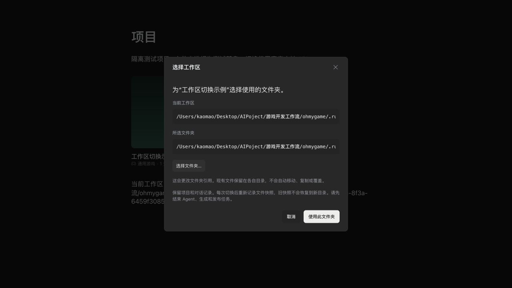

# Choose a workspace for an existing project

[中文](project-workspace.zh-CN.md)

Open a project's **… → Choose workspace** menu on Projects, Home, or a Studio
entry page. Review the current path, choose a folder with the desktop file picker,
then click **Use this folder**. Cancelling the picker or dialog changes nothing.
This requires the desktop app; an ordinary browser cannot open a native folder picker.

The project keeps its ID, type, name, settings and conversations. This changes
the workspace reference: no source files are moved, copied or overwritten.
Choose the folder containing the files you intend to work on. If moving an
existing game, copy its files to the destination separately before switching.
Preview startup settings are retained and may need adjustment for the new folder.
The previous preview stops; the new folder is not automatically executed.

Wait for agents, generation and publishing to finish. In-flight file writes drain
before a switch; new writes from stale editors are refused. A pending interrupted
file restore must be recovered first. Other open project views reload after the
workspace change, and agent sessions are recreated against the new directory.

Filesystem roots, missing folders, symlink selections, OhMyGame's internal project
storage, and folders overlapping another project's workspace are refused for a switch.
An existing unavailable workspace can be reattached by selecting its new location.
Selecting the current workspace again is a no-op.

File checkpoints belong to a workspace selection. Each actual switch starts a new
checkpoint namespace; earlier conversation snapshots remain stored, but cannot
restore files into the newly selected directory. Switching back also starts a new
namespace. Conversation references and attachments may still refer to the old
folder, so inspect the current files before continuing.

The optional `workspaceCheckpointId` metadata field names that namespace;
pre-existing projects retain their original `checkpoints` store until switched.
The namespace and selected path persist in the same atomic `project.json` update.
Workspace notices and version checks prevent older editors from saving into the
new folder, including when shutdown interrupts the following notice write.

The daemon endpoint is `PUT /projects/:projectId/settings/workspace` with
`{"workspacePath":"/absolute/folder"}` and the current `x-workspace-version`
header obtained by reading the project. It returns the updated project and version.
A busy or stale workspace returns HTTP 409. This is a project setting; it does not
change the application's global data directory.

The example uses isolated fixture data and a folder-picker test double; saving calls the real local daemon.
