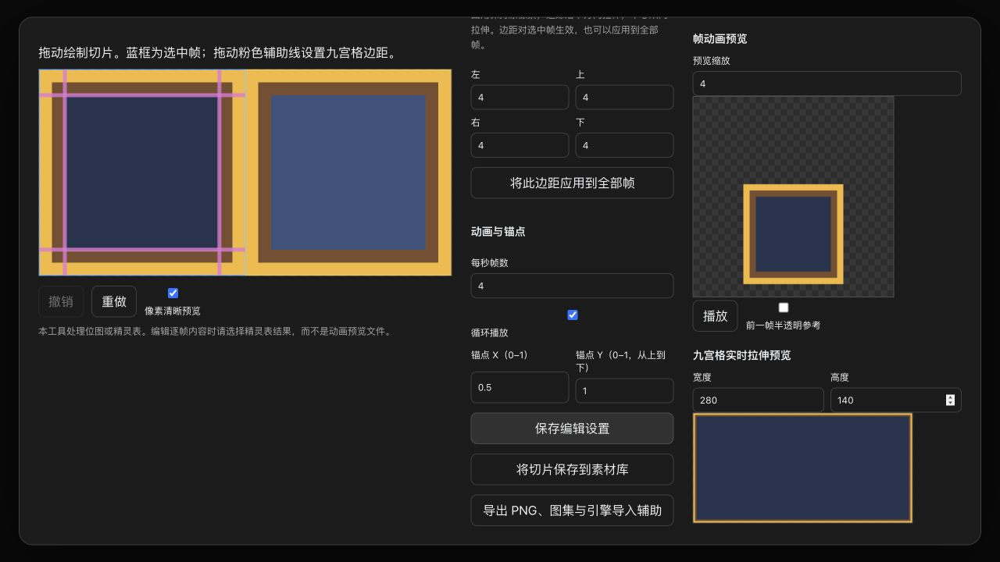

# SpriteCook 与本地 2D 工具

[English](spritecook.md)

**状态：`feat/spritecook-2d` 上的实验性实现。** 当前分支已包含只填 Key 的连接、
公开 REST 能力、本地切图／动画／九宫格、素材库和画板入口，以及 Agent 工具。
集成目标仍是 `RemixCat/ohmygame:studio`。

公共接口测试和隔离浏览器流程使用模拟服务商响应，没有使用真实 SpriteCook 密钥或付费生成。
这些验证不代表真实生成质量，也不代表所有引擎版本都已验证。
真实服务商验收完成前，功能 PR 保持草稿。

## 运行与连接

```bash
git clone --branch feat/spritecook-2d https://github.com/RemixCat/ohmygame.git
cd ohmygame
bun install --frozen-lockfile
bun run dev:desktop
```

在**设置 → 服务商与模型 → 图片 → SpriteCook**填写自己的 Key，点击**检查连接**验证目录。
需要 `generate`、`read_assets` 权限，显示余额时另需 `read_credits`。
本地编辑与导出不需要模型密钥。环境准备与排查仍见 [CONTRIBUTING.md](../CONTRIBUTING.md)。

从画板、素材库工具栏或 SpriteCook 设置页打开 **2D 素材工作台**，选择已有素材或上传
PNG/JPEG/WebP/GIF。逐帧编辑请选择精灵表；当前不会把动画预览文件解码成时间轴。
保留原始媒体，处理结果作为新素材保存。



截图使用确定性的测试美术，不是 AI 生成质量样例。

## 预期使用流程

在**设置 → 服务商与模型 → 图片**中提供固定的 **SpriteCook** 服务商卡片。
只需填写 API Key，默认地址为 `https://api.spritecook.ai`。
动画和切图是独立操作，不隐藏在普通图片生成参数里。

当前工作台提供的操作：

| 操作          | 输入                                             | 结果                           |
| ------------- | ------------------------------------------------ | ------------------------------ |
| 精灵／UI 素材 | 提示词、参考图、像素或高清模式、主题、调色板     | 本地图片及生成元数据           |
| 2D 精灵动画   | 已有图片、动作描述、支持的模型与帧数、去背景选项 | 原生动画预览、精灵表、帧信息   |
| 自动切图      | 透明组件表、识别阈值、最小面积、留白、合并间距   | 可检查的切片区域与本地独立图片 |
| 地形瓦片      | 地形描述、视角、排列规格、支持的瓦片大小、调色板 | 本地瓦片图集与布局信息         |

选中画板图片后打开工作台，或直接选择素材库中的图片，不必重新用 SpriteCook 生成原图。
需要服务商素材 ID 的操作会先导入本地原图。结果可以作为普通素材节点添加到画板。
本版没有新增持久化的生成节点类型，也不会自动执行图上的连线，原有画板文件格式保持不变。

## 公开 API 依据

文档核对日期：**2026-10-18**。模型和价格可能变化，以实时目录和实际响应为准。

- [API 参考](https://www.spritecook.ai/api-docs)
- [OpenAPI 定义](https://www.spritecook.ai/openapi.json)
- [UI Kit Builder](https://www.spritecook.ai/docs/ui-kit)
- [逐帧动画指南](https://www.spritecook.ai/docs/guide-frame-animation)

OpenAPI 比简版接口介绍多列出了一些能力：

| 用途               | 公开接口                                                                                                                                                           |
| ------------------ | ------------------------------------------------------------------------------------------------------------------------------------------------------------------ |
| 模型目录与余额     | `GET /v1/api/models`、`GET /v1/api/credits`                                                                                                                        |
| 导入原图与素材信息 | `POST /v1/api/assets/import`、`GET /v1/api/assets/{asset_id}`                                                                                                      |
| 图片生成           | `POST /v1/api/generate`                                                                                                                                            |
| 动画               | `POST /v1/api/animate`                                                                                                                                             |
| 角色创建与动作批次 | `GET /v1/api/character-workflows`、`POST /v1/api/characters`、`POST /v1/api/characters/{character_id}/animations`、`GET /v1/api/character-animation-runs/{run_id}` |
| 自动组件切图       | `POST /v1/api/assets/{asset_id}/auto-slice`                                                                                                                        |
| 瓦片               | `GET /v1/api/tilesets/options`、`POST /v1/api/tilesets`                                                                                                            |
| 去背景与边缘清理   | `POST /v1/api/remove-background`、`PUT /v1/api/assets/{asset_id}/alpha-cutoff`                                                                                     |
| 任务生命周期       | `GET /v1/api/jobs/{job_id}`、`POST /v1/api/jobs/{job_id}/cancel`                                                                                                   |

### 需要保留的功能边界

- 当前公开定义没有完整 UI Kit Builder 接口，不能承诺直接调用按钮状态分组、
  九宫格编辑或 Unity/Godot 打包导出。
- 网站上的指定帧参考和局部帧重生成，不在核对过的 `ApiAnimateRequest` 参数中。
- 自动切图识别的是可见像素的连通区域，不能从任意截图中理解并提取互相遮挡的控件。
  必须保留原图，让用户在导出前检查、修正区域。
- 帧数规则、原图尺寸限制随模型不同，提交前需要校验。图片生成的请求尺寸可能只是提示，
  必须检查实际结果，不能把请求尺寸直接记成输出尺寸。
- 只按可见区域切动画，可能拆散身体部件或改变锚点。动画应保留统一画布与对齐，
  自动组件切图不能当作通用动画切帧器。

## 本地编辑与导出

九宫格是确定性的图片渲染规则，不是模型能力：四角保持尺寸，边缘单向拉伸，中心双向拉伸。
拖动粉色辅助线或输入像素边距。每个组件可以单独设置；**将此边距应用到全部帧**可以复用当前边距。

- 手绘或修改切片区域；网格切帧支持行列、间距、外边距，不能整除的配置会明确报错，避免偷偷丢像素。
- 指定 UI 组件系列与交互状态，同一系列不能重复同一状态。命名和分组由用户指定，尚无 AI 语义解析器。
- 调整帧顺序、帧率、循环与统一锚点；提供缩放、像素清晰预览、前一帧半透明参考、撤销和重做。
- 只有动画元数据与图片实际尺寸相符时才自动初始化切帧；服务商帧数、尺寸错误会报错，不假装成功。
- 保存编辑设置、将保留原像素的 PNG 切片保存到素材库，或导出 ZIP；保留源文件。
  原图上限 1600 万像素、256 帧，打包图集上限 8192 像素／1800 万像素。

ZIP 包含 `source.png`、独立 `frames/*.png`、`manifest.json`、带 1 像素边缘扩展的
PNG 图集与 TexturePacker 风格 JSON、Unity Editor 导入脚本、Godot 4 EditorScript。
清单使用**左上角像素坐标**，锚点也从左上角归一化。Unity 脚本会转换矩形 Y、锚点 Y、边距顺序；
Unity 需要 2022.3+ 和 2D Sprite 包，Editor 导入脚本在项目中只安装一次，不要每套素材重复复制。
Godot 脚本生成 SpriteFrames、StyleBoxTexture，并为 normal/hover/pressed/disabled 系列生成 Button Theme。
具体导入步骤见 ZIP 中的 `README.txt`。这些辅助工具不会自动搭出完整交互界面，也不代表游戏已跑通。

## 任务恢复与 Agent

固定地址为 `https://api.spritecook.ai`，使用异步提交与查询；同步接口是同一能力的等待版本，
不作为独立制作模式。目录读取、原图导入、素材信息接口也可使用。

后端把密钥独立保存到私有权限的 `spritecook-key.json`，读取接口只返回连接状态。
任务参数、远端 ID、原生媒体引用与结果保存在 `spritecook-jobs.json`，本地编辑设置保存在
`sprite-recipes.json`，均位于应用数据目录，不能提交进仓库。

重启后继续查询已知任务。结果按真实 PNG/JPEG/WebP/GIF 格式保存，不改扩展名冒充格式。
下载失败保留任务 ID，可以继续获取；提交超时不明确时标记为待核对，去服务商后台找到任务后关联，
不会自动重复付费生成。只有服务商明确确认时才标记取消；公开接口没有角色动作批次的整体取消接口。
批次部分失败会保留成功结果，手工重新提交时请只选择失败动作 ID。

有权限时显示服务商余额，不编造单次费用估算，价格与账号权限由 SpriteCook 决定。
下载结果时不能把 API Authorization 带到其他下载域名。

Agent 工具 `spritecook`、`sprite_tools` 复用相同能力。前者返回可恢复任务；后者可列图片、
编辑清单、切图、导出，或将素材复制到当前项目的 `assets/generated/`。
复制素材不等于接入引擎，Agent 仍需实际引用到游戏中并验证行为。

## 验收与剩余验证

- 校验正常与异常的任务、动画、切片、元数据响应；清楚报出缺文件、尺寸不一致和不完整输出。
- 验证轮询、重启恢复、取消、额度／限流、批次部分失败，不意外重复发起付费生成。
- 验证本地图导入、原生预览格式、帧数／尺寸记录、切片坐标，并按游戏实际大小检查透明边缘和锚点。
- 验证密钥隐藏、断开连接、禁用服务商、更换账号，不在不相关账号之间复用远端素材 ID。
- 运行仓库公共检查，实际操作设置和画板流程。CI 使用模拟响应；真实效果通过少量明确的实测验证。
  对外只发布已去除敏感信息的证据，不公开凭据或私人项目。

## 与上游兼容

遵循 [Fork 维护指南](fork-maintenance.zh-CN.md)。服务商文件和注册点保持独立，
新增节点／素材契约需要版本与迁移说明。官方增加同类工具后，先对比能力，再迁移已有密钥、
存档节点、本地素材和未完成任务，最后移除旧适配。
不能因为上游出现同名功能就自动删除现有流程。

## 本次验证记录

- 公共测试：2,914 项通过，23 项跳过；另有针对后续导出修正的定向回归检查。
- 隔离浏览器实测了辅助线拖动、撤销、九宫格拉伸、保存、模拟动画任务完成、元数据切帧与 ZIP 下载。
- Unity 6000.3.23f1：从导出包生成 2 个 Sprite，验证了非对称 Y 坐标转换、锚点和四边九宫格数值。
- Godot 4.7.1：实际运行导入脚本并验证 SpriteFrames、AtlasTexture 区域、StyleBoxTexture 边距和 Button Theme；
  headless 编辑器在立即退出时有清理警告，资源断言通过。
- SpriteCook 真实密钥生成、计费、限流与账号差异尚未验证；网站未公开的逐帧参考／重绘接口不在接入范围内。
