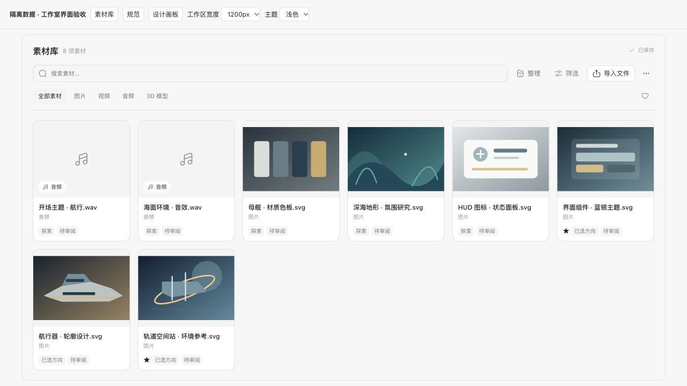
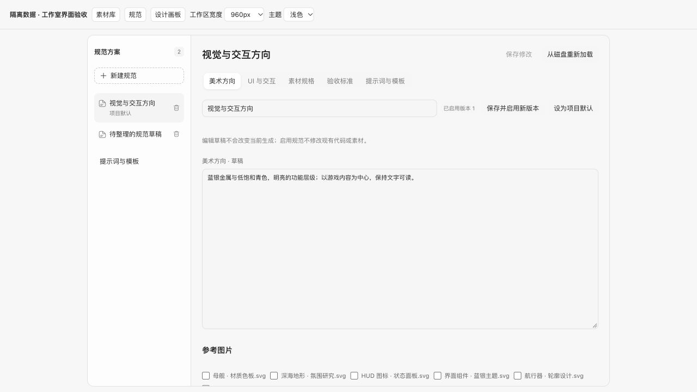
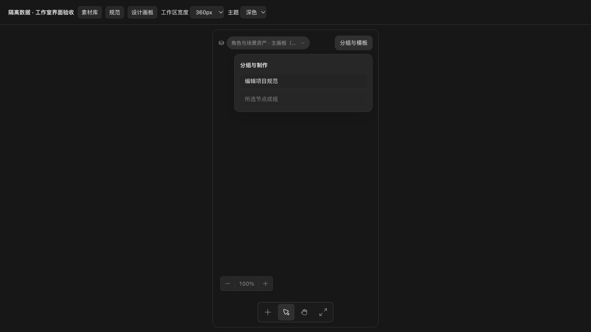

# Studio interface validation — 2026-10-18

This update repairs standard creation/removal and makes Library and canvas
controls respond to their available work area. See the
[English workflow guide](studio-workflow.md) and
[中文使用说明](studio-workflow.zh-CN.md).

## Behavior and screenshots

- New standard opens a name dialog; Cancel creates nothing. A repeated submit
  creates one item, including under React StrictMode. Duplicate active names are
  rejected. Creating from Templates returns to the new art-direction editor.
- Unpublished drafts can be deleted. Published standards are archived and can
  be restored; past revisions and generation receipts remain immutable.
  Removed references no longer constrain new generation. Save changes persists
  creation, removal and restoration, with the existing conflict protection.
- Library starts with its gallery, search, media tabs and import. Organization,
  advanced filters and the inspector open when needed. Bulk tools appear only
  for checkbox selections. Audio cards retain their music icon when a cached
  audio URL exists. The preview integration retains the 2D workbench entry.
- Canvas actions share a wrapping toolbar, with the group panel below it.
  Zoom controls move above the bottom toolbar in narrow split panes.
- A canvas containing only valid production metadata can initialize its first
  board without changing that metadata. Other missing-index directories still
  require recovery, protecting authored boards and documents.

These screenshots use deterministic SVG/WAV fixtures and isolated local data.
They demonstrate layout and interaction, not generation quality.

## Verification

Public checks passed: pinned plugin preparation, changelog check, TypeScript,
renderer/sandbox builds and Node daemon/player startup. The focused `studio` contribution suite passed **2900 tests**; the integration
preview passed **2933 tests**. Both completed with **23 expected skips** for unavailable private
cloud/environment-dependent checks. Model credentials were removed from the test
environment. No paid generation was submitted.

New tests cover creation/cancellation/repeated submit, duplicate names, draft
deletion, published archive/restore, inherited-standard fallback, immutable
receipts, Library controls and audio thumbnails, standards-first initialization,
and protection of authored missing-index canvases. A pre-existing checkpoint
test compared concurrent completion order with disk invocation order; assertions
now compare matching tool call identities.

Browser verification used real components and an isolated daemon. Standards,
Library and canvas controls were checked at work-area widths **1200, 960, 720,
520 and 360 px**, in both light and dark themes. Geometry checks found no
overlapping toolbar controls or horizontal overflow. The long board title,
expanded group panel, advanced filters, bulk toolbar and narrow inspector were
also checked. Search, audio filtering and opening the 2D workbench were exercised.
Name/create/cancel, draft removal, published removal/restore, saving and reload
were verified through the UI and the production API.

This does not verify paid provider output, private hosted publishing, or every
operating-system font/scale combination. Published standards use an optional
`archived` field in production metadata; back up data before downgrading to a
version whose schema does not accept that field.
